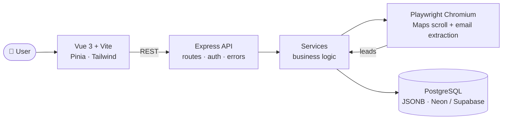
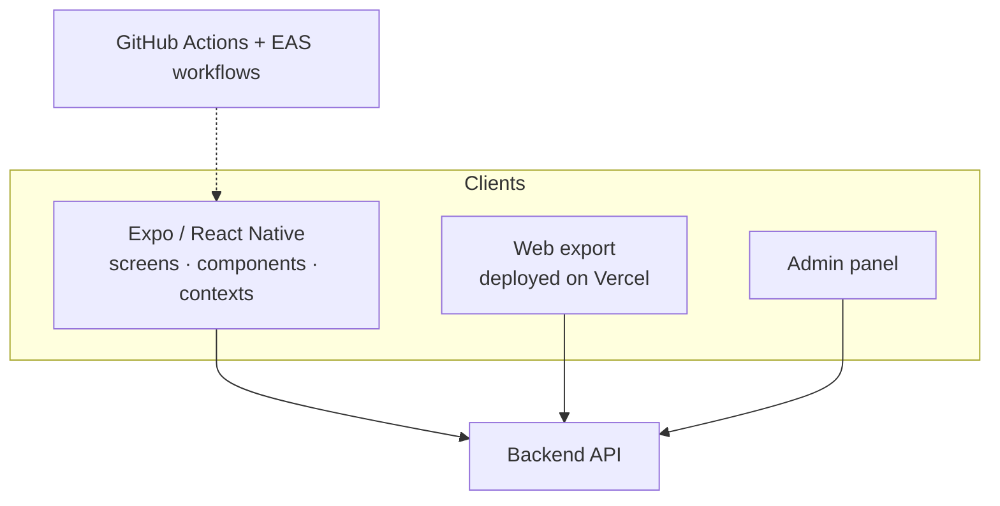

<!-- ╔══════════════════════════  HERO  ══════════════════════════╗ -->

  

  

<!-- ╚══════════════════════════════════════════════════════════╝ -->

## 💫 About Me

  

 

<!-- ✏️ EDIT THESE LINES so they sound like you -->
| | |
|---|---|
| 🔭 **Currently working on** | **Theron** (Maps lead-gen platform) · **SpotMe** (Expo mobile + web app) |
| 🌱 **Currently learning** | Next.js · EAS build pipelines · production-grade Playwright crawling |
| 👯 **Open to collaborate on** | Full-stack & mobile products, automation tooling |
| 🤝 **Looking for help with** | Scaling scrapers, mobile performance, CI/CD |
| 💬 **Ask me about** | Vue 3 + Pinia, Express APIs, Expo/NativeWind, Playwright scraping, Postgres JSONB |
| ⚡ **Fun fact** | I built a stickman platformer whose body literally grows with every level 💪 |

---

## 🚀 Featured Projects

 

<h3>🎯 Theron — Google Maps Lead Generation & Pipeline System</h3>

> High-performance Maps lead generation, contact enrichment & pipeline management.
> Search any industry in any location → auto-extract business data → enrich with verified emails & contact channels → manage each lead through a **7-stage workflow pipeline**.

  
  
  

| Layer | Tech |
|---|---|
| Frontend | Vue 3 Composition API · Vite · Tailwind (pure black/white, Vercel-inspired dark theme) · Pinia · Lucide · IBM Plex Mono + Manrope |
| Backend | Node.js · Express · Playwright Chromium crawler · modular `config / db / middleware / routes / services / utils` |
| Data | PostgreSQL with JSONB + cascade-safe relations (Neon / Supabase / local) |
| Deploy | Frontend → Vercel · Backend → Render / Railway / DigitalOcean |

<h3>📍 SpotMe — Cross-Platform App (Mobile + Web + Admin)</h3>

> A TypeScript Expo app with its own backend and admin panel, exported to the web and deployed on Vercel. Actively developed: **240+ commits**.

  
  
  
  

| Area | Tech |
|---|---|
| App | Expo · React Native · TypeScript · file-based `app/` routing · NativeWind (Tailwind for RN) |
| Structure | `screens` · `components` · `contexts` · `constants` · `utils` · `admin` · `backend` |
| Release | EAS builds (`eas.json`, `EAS_WORKFLOW.md`) · Vercel web hosting · GitHub Actions |

<h3>🔧 Workshop — Backend + Mobile App + Web Frontend</h3>

A multi-part project with three codebases in one repo: `backend/`, `repairo-app/` (mobile) and `webfrontend/` (web), plus CI in `.github/workflows` and a `check_schema.js` database-schema check script.

  
  

<!-- ✏️ Add 1-2 lines about what this app does and its stack -->

<h3>🥊 Agon — Stickman Evolution (Game)</h3>

A landscape obstacle platformer starring one large animated stickman: move him directly, jump over traps, punch through walls and reach the exit. **Every completed level increases his strength and visibly grows his shoulders, torso, arms and legs.**

  
  
  
  

Touch-first design: multi-touch **Pointer Events**, landscape orientation locking, and **Playwright phone-emulation tests** for layout and input logic.

---

## 🧰 Tech Arsenal

| 🎨 Frontend | 📱 Mobile | ⚙️ Backend | 🗄️ Data & Automation | 🚢 DevOps |
|:---:|:---:|:---:|:---:|:---:|
|  |   |  |   |  |

<b>🔎 Full stack list (detected from my repos)</b>

- **UI:** Vue 3 (Composition API), Pinia, Vite, Tailwind CSS, NativeWind, Lucide icons
- **Mobile:** Expo, React Native, EAS Build, TypeScript
- **Server:** Node.js, Express, JWT-style auth middleware, modular service architecture
- **Data:** PostgreSQL (JSONB), Neon / Supabase
- **Automation:** Playwright Chromium crawling, email extraction, Google Maps scraping
- **Delivery:** Vercel, Render / Railway, GitHub Actions, EAS workflows
- **Testing:** Playwright (phone emulation, layout & input tests)

---

## 🔴 Live from GitHub

> Everything in this block is rewritten automatically every 6 hours by a GitHub Action.

### 📦 Recently Active Repositories
<!--START_SECTION:repos-->
_Loading… (run the **Update README** workflow once)_
<!--END_SECTION:repos-->

### ⚡ Recent Activity
<!--START_SECTION:activity-->
_Loading… (run the **Update README** workflow once)_
<!--END_SECTION:activity-->

<!--START_SECTION:updated-->
<!--END_SECTION:updated-->

### 🛰️ Repo Health

| Repo | Last commit | Monthly commits | Top language | Size |
|---|---|---|---|---|
| **Theron** |  |  |  |  |
| **SpotMe** |  |  |  |  |
| **Workshop** |  |  |  |  |
| **Agon** |  |  |  |  |

---

## 📊 GitHub Analytics

<b>🧬 Deep metrics (languages · coding habits · 3D calendar)</b>

 

  <!-- Generated by .github/workflows/metrics.yml (needs METRICS_TOKEN secret) -->
  
  

### 🏆 Trophies

---

## 🐍 Contribution Snake

<picture>
  <source media="(prefers-color-scheme: dark)" srcset="https://raw.githubusercontent.com/alen899-my/alen899-my/output/github-snake-dark.svg" />
  <source media="(prefers-color-scheme: light)" srcset="https://raw.githubusercontent.com/alen899-my/alen899-my/output/github-snake.svg" />
  
</picture>

---

## 🎯 Currently Levelling Up

- [x] Ship a full-stack scraping + CRM-style pipeline (**Theron**)
- [x] Publish a cross-platform Expo app to web (**SpotMe**)
- [x] Build and test a touch-first browser game (**Agon**)
- [ ] Master Next.js App Router & server components
- [ ] Production-grade EAS pipelines for store releases
- [ ] Harden crawlers: queues, retries, rate-limits
- [ ] Contribute to open source

---

## ✍️ Dev Quote of the Moment

---

## 🤝 Let's Connect

<!-- ✏️ Uncomment + edit:

-->

 

